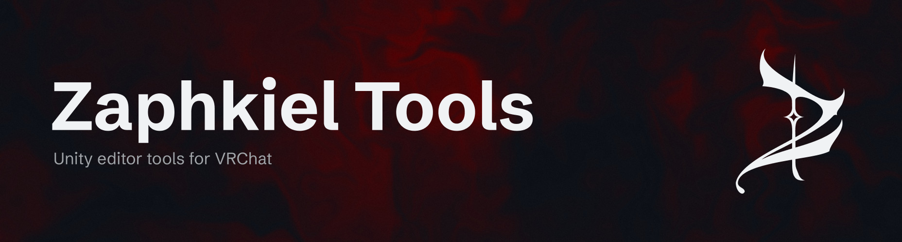

Unity editor tools for building VRChat avatars. I write them for my own avatars and publish them here.

## Tools

| Tool | What it does |
| --- | --- |
| [Toggle Creator][toggle-creator] | Builds a dissolve toggle in one pass: the on, off and transition clips, then the animator layer with its parameter, states and transitions. It works with Poiyomi's Dissolve and Geometric Dissolve, and tells you which objects have materials without them. |
| [VRAM Inspector][vram-inspector] | Lists what each texture and mesh of an avatar costs in VRAM. The texture total uses the same calculation as the VRChat SDK's Texture Memory stat. It removes textures left in material slots that the current shader does not read. |
| [Avatar Analyzer][avatar-analyzer] | Reports on one avatar: polygons, texture and mesh memory, materials, bones, PhysBones, contacts, constraints and animator layers, each with its performance rank. It flags Write Defaults mismatches and empty states, and exports the report to CSV. |
| [VRC Build Size Viewer][build-size-viewer] | Reads the Editor log after a build and shows the uncompressed size by category and by asset. |
| [VRCSDK+][vrcsdkplus] (fork) | Replaces the SDK inspectors of Expression Parameters and Expression Menus. It adds a synced bits bar, checks parameters against the avatar's controllers, copies and moves menu controls, and lists the parent menus of a menu. |
| [Unity Discord Rich Presence][udrpc] | Shows the project name, the open scene and the session time on your Discord profile. You can turn it off per project. |

## Requirements

Unity 6000.0 with the VRChat Avatars SDK 3.11. I use and test this setup. I do not test older versions.

## Bugs and requests

Open an issue on the repository of the tool. Include your Unity version, your SDK version and the Console error.

[toggle-creator]: https://github.com/ZaphkielTools/ToggleCreator
[vram-inspector]: https://github.com/ZaphkielTools/VramInspector
[avatar-analyzer]: https://github.com/ZaphkielTools/AvatarAnalyzer
[build-size-viewer]: https://github.com/ZaphkielTools/BuildSizeViewer
[vrcsdkplus]: https://github.com/ZaphkielTools/VRCSDKPlus
[udrpc]: https://github.com/ZaphkielTools/UnityDiscordRichPresence
